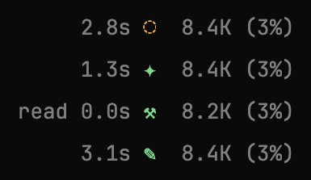
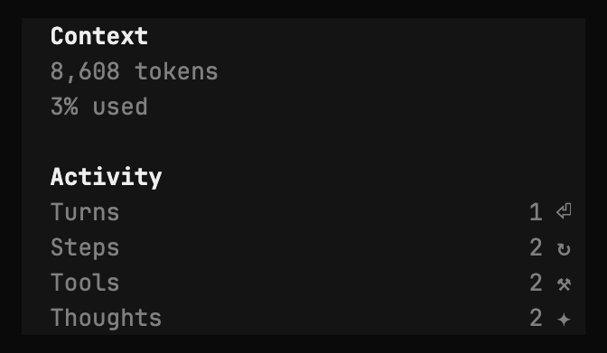

# opencode-activity

An OpenCode v2 TUI plugin that shows the current session's activity counts,
and what the model is doing right now, in the prompt footer:



*The footer through one run: waiting, thinking, running a tool, writing, and
idle.*

| Symbol | Count    | Meaning                                         |
|--------|----------|-------------------------------------------------|
| `↑`    | Turns    | Your prompts (user messages)                    |
| `⟳`    | Steps    | Model calls (assistant messages)                |
| `⚒`    | Tools    | Tool calls made by the model                    |
| `✦`    | Thoughts | Reasoning blocks (when the model emits them)    |

A turn with two tool calls followed by a reply is three steps.

While a run is active, a live indicator with elapsed time appears before the
counts:

    4.2s ✦  3↑ 6⟳ 3⚒ 6✦

| Indicator     | Phase                                                |
|---------------|------------------------------------------------------|
| `1.2s ◌`      | Waiting for the model (request sent, no output yet)  |
| `4.2s ✦`      | Thinking (streaming reasoning)                       |
| `0.8s ✎`      | Writing (streaming reply text)                       |
| `read 2.1s ⚒` | Calling or running a tool                            |

It's hidden when the session is idle and during retry backoff.

When the sidebar is open, it also gets an "Activity" section with the same
counts, labeled:



Screenshots are tmux captures rendered to PNG; glyph shapes depend on your
terminal font.

## Install

Add the repo's absolute path to the `plugins` array in
`~/.config/opencode/opencode.json`:

```json
{
  "plugins": ["/path/to/opencode-activity"]
}
```

Alternatively, OpenCode discovers directories (or symlinks to directories)
under `~/.config/opencode/plugins/` or `<project>/.opencode/plugins/` without
any config entry. Use one method, not both: the paths differ, so the plugin
would load twice. Restart OpenCode to load it.

## How It Works

- `tui.tsx` appends to the `prompt.footer.status` slot (after the built-in
  status) and the `sidebar.content` slot; both read the same shared counts.
- `server.ts` is a no-op server entry. Plugins listed in `opencode.json` are
  loaded by the server first, and one without a server entry never reaches
  the TUI.
- `phase.ts` tracks the live phase per session from step, text, reasoning,
  tool, retry, and execution events, timed from each event's `created`
  timestamp.
- Full counts come from the message API (`type: "user"` and
  `type: "assistant"`, counting `tool` and `reasoning` content parts), paging
  through the full history, since the TUI's message store holds only the most
  recent messages.
- While a run streams, step, tool, and reasoning events bump the counts
  directly; a full recount (debounced) runs when a run starts or ends, and
  after reverts and compactions.
- OpenCode applies the Solid JSX transform to plugin files outside
  `node_modules`, so the `.tsx` source loads directly with no build step.
  Publishing to npm would require pre-bundling, as files under `node_modules`
  are not transformed.

Tested with OpenCode 2.2.6.
